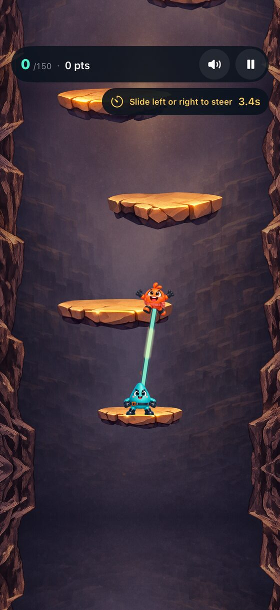
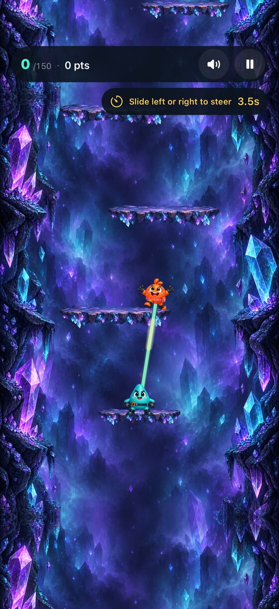

# Sling Duo

**Two climbers. One elastic rope. A way back to daylight.**

Sling Duo is a single-player arcade game for iPhone and iPad. Launch one climber, steer through the cave, catch a platform, and let the rope send their partner upward. Keep the rhythm going until the duo escapes.

  
  &nbsp;&nbsp;
  

## How to play

- Drag and release to launch the first climber.
- Steer in flight using device tilt or optional touch-based Slide controls.
- Catch a platform to automatically launch the partner.
- Reach 150 catches to escape a cave and unlock the next expedition.
- Build combos, land perfect catches, and continue climbing in Endless mode.

## Features

- Nine visually distinct caves and a progressive campaign
- Tilt and touch controls
- Per-cave scores, combos, height, and fastest Escape records
- Moving, precision, and trick platforms
- Optional Turbo mode with separate records
- Offline play with no accounts, ads, analytics, or in-app purchases
- Local progress and preferences

## Run the project

1. Open `Sling Duo.xcodeproj` in Xcode.
2. Select the **Sling Duo** scheme and your signing team.
3. Run on an iPhone or iPad with iOS 17.6 or newer.

A physical device is recommended for tilt controls, haptics, and audio behavior. Unit and UI tests can be run with **Product → Test**.

## Built with

SwiftUI, SpriteKit, Core Motion, UIKit, and AVFoundation.

## Privacy and support

Sling Duo processes motion input on-device and does not collect or transmit personal data.

- [Privacy Policy](https://sgazz.github.io/Sling-Duo/privacy.html)
- [Support](https://sgazz.github.io/Sling-Duo/support.html)
